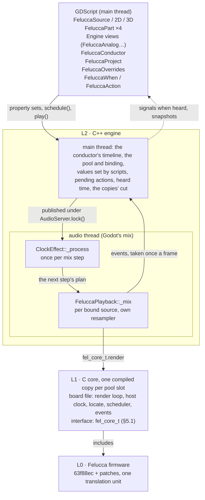

# Felucca in Godot: design

Working notes for implementing (and possibly re-implementing differently) a GDExtension that runs Felucca headless in a Godot game. Written from the research conversation of 2026-10-24. Claims marked _measured_ have a test: `core/tests/run.sh`, `extension/run_tests.sh` or the web runners (DEVELOPING.md says what each covers). The first measurements came from C prototypes and a Godot spike, removed in 6d13c9a (DEVELOPING.md says how to restore them); where a decision rests on one of those, it quotes the numbers.

How to use this doc: §3 is what was decided and why; §11 lists the alternatives and which layer each one replaces, so switching approach means swapping one layer behind an interface that stays put (§4.1, §5.1). §12 is what is still open; §13 the milestones.

---

## 1. Requirements (from the user)

|  | Requirement |
| --- | --- |
| R1 | Synthesize sound in a Godot game with Felucca, headless. An optional debug view of the device screen only if cheap. |
| R2 | Sounds and sequences are designed on the user's FM-1 (Felucca **1.6.1**) and exported with the Felucca web app (project `.json`); the game loads them, each sound source with its project and per-source overrides (e.g. a part muted initially). |
| R3 | Every parameter controllable from code **directly** (e.g. ARP RATE), never by driving the emulated UI. |
| R4 | Several instances running concurrently, managed as a **pool** smaller than the number of in-world sources (§7). |
| R5 | Type safety against typos in scripts: no free-string parameter names. |
| R6 | All instances in sync, driven from the Godot side, for minutes at a time, with no drift. |
| R7 | Tempo tweened from Godot like any property (int tweens; float too, e.g. from the player's distance), at any tempo, without song mode. |
| R8 | Scheduling in musical time: "switch track 1 to another pattern on the next loop", "when the sequencer reaches step 14". |
| R9 | Scripts react to scheduled events and to sequencer steps/beats, in time with what is heard (particles on each knock). |
| R10 | GDExtension via godot-cpp (or godot-rust). |
| R11 | **Godot 4.7.2** (latest stable); moving to a later stable minor must be easy when GDExtension and audio have not broken. |
| R12 | **Pause stops all sound and all musical time**, so audio-synced events stay in sync; respect `stream_paused` of the players unless there is a good reason not to. |
| R13 | Nothing persists between sessions: instance memory (flash image) is thrown away. |
| R14 | Licence: the game is released as **GPL-3.0** (decided by the user). |
| R15 | Web export if possible; otherwise desktop only. |
| R16 | Development continues in Claude Code CLI on the user's machine (this folder, a local git repo). |

Motivating scenario (M6's demo; not an automated test, which would test too many parts at once: M6's pieces are tested one by one, the user's decision 2026-10-26): the player triggers a "knock": four kicks on steps 1, 5, 9, 13 of the drum track's **next** loop, each emitting particles on the door in time with the sound; one loop later the door opens and a cutoff sweep starts. Pool scenario (M5): cellar (5 sources), hallway (1 + 2 cellar sources still audible), bedroom (hallway + 4), with a pool of 8.

## 2. Facts about Felucca the design depends on

Felucca main `63f88ec` (5 commits after 1.6.1: README/licensing, #282 a BPM-0 guard in `fx.c beat_samples()`); the user's device runs 1.6.1, whose project format is the same (FUN10). The maintainer has stepped back.

- **One translation unit.** `firmware/src/felucca.c` `#include`s every source. `web/emu/felucca_web.c` (the browser emulator's _board file_) builds the same firmware against a simulated FM-1: it includes `tests/hostsim.c` (libc, engines, voices, FX, sequencer), then audio, UI, storage, projects. Nearly all state is `static`; the only global data names are `panel settings proj_slot bootguard felucca_dbg` plus linker markers (`_bss_start`…) and the functions (`web_*`, `felucca_mem*`, `isr_*`, `fm1_*_irq`, `hostsim_main`). _Measured_ with `nm`.
- **Board-file ABI** (`web_*`): `web_boot`, `web_render(n)` → `web_out_l/r`, `web_midi(status,d1,d2)` (channel messages only), `web_keys/buttons/enc/master`, `web_screen()` (240×240 RGB565, high byte first), LEDs, `web_nor()` (1 MiB flash image). Fixed **44.1 kHz**. Built `-sSTANDALONE_WASM`, the wasm has no imports.
- **Time.** `web_ms()` = one device millisecond: the audio ISR for every 128-frame half due, the main loop (`web_frame`: UI, settings/autosave polls, LEDs, drawing) every 15 ms. The ISR renders a half as four `CTL` = 32-sample blocks; `events_block(n)` (seq.c) runs once per block: MIDI in, `seq_tick`, arps, metronome, beat counter. **Step timing resolution is one 32-sample block (0.73 ms)**, on the hardware too.
- **Parameters.** `trk[4].p[P_COUNT]` (per part), `song.g[G_COUNT]` (global), `int16_t`; the audio ISR reads them as they are, so a direct write takes effect live (_measured_). Reference write path = the editor protocol's ED_SET / ED_TRACK_PARAM: clamp to the descriptor, `enum_orig()`, `motion_capture()`, `ui.force = 1`. Engines: `set_engine_of()`.
- **Descriptors.** `params.c`: `TP[]`, `GP[]` (label, fmt, min, max, def, enum names); engine parameters from `ENGINES[e]->edit[8]` via `track_desc()`; pages in `PAGES[]` (title, scope, 4 ids). Dump: `build/gen_api/params.json` (`core/tools/dump_params.c`, built by SConstruct).
- **Projects.** The web app's `Felucca-project-*.json` = `{format:"felucca-project", version:1, firmware, slot, object:{size, crc, data}}`: `crc` is CRC-32 (zlib) of the decoded bytes, `data` base64 of the 3840-byte FUN10 store object (`proj_pack()`; `editor_backup.c` packs exports the same way; accepted sizes 3840 3648 3584 3388 for older formats). Load: `proj_import(&q, bytes, n)` (migrates) + `project_restore_runtime(&q)`. A project holds the four parts' sounds, 64-step patterns, LEN/DIV/SWING/GATE, the song chain, automation/locks, FM6 patches, its name and BPM. **Not** user sample audio, the user-preset library or settings. _Measured_ with the user's own export (now the test project, `demo/tests/project.json`).
- **Patterns** are per track: `trk[t].step[64]` + P_SLEN/SDIV/SSWING/SGATE (+ P_SQNT) + that track's records in the shared `motion` store. Song mode (`song_chain.c`) plays copies of up to four saved projects' patterns per section; `seq_steps(t)` returns the steps that play.
- **Transport/clock.** `seq_start()` / `seq_stop()`; no Song Position Pointer and no "locate" (§6.4 adds one). Internal clock: integer `G_BPM` 40..240, quarter = `floor(44100·60/BPM)`, step = `floor(quarter / divisor)`; a tempo change does not rescale the step in progress. External clock: 24-ppqn pulses timestamped in whole device ms, tempo re-measured every 6 pulses as whole ms.
- **beat_samples()** feeds the delay time (read point jumps on change), synced LFOs, ENV SYNC, gates, ratchets.
- **Not in the board file:** USB (audio, MIDI out, editor SysEx), TRS MIDI, user sample slots, battery, crash/UBOOT.
- **Host-only imports** from `tests/hostsim.c` (`fork pipe waitpid fopen fwrite …`) are never called but must link: stub them on Windows/web (felucca-vst has Windows stubs in `core/win/`).

## 3. Decisions

Each decision says what was chosen, why, and what it was chosen over (the A-numbers are §11's alternatives).

- **D1. Felucca's own C code, not a chip emulation.** The extension runs Felucca's firmware source through a board file. Why: setting parameters directly from code (R3) needs the firmware's own structures, and it is cheap: 1.2 % of a core for the heavy test song (_measured_). Instead of: an emulator of the device's chip (A5).
- **D2. We own the board file.** It includes Felucca's browser build (`web/emu/felucca_web.c`, forked only if needed) and owns the render loop around `web_ms()`. Why: the host clock, the scheduler, the events and `locate` hook in between its halves and blocks.
- **D3. A pool of copies compiled into one binary.** Each instance is a compiled copy of the core of its own, with one entry point, `fel_core_<n>()` (a function table). Generated preprocessor renames keep the copies apart (`-Dpanel=fel3_panel …`, the list taken from `nm` of a reference build and checked by a 2-copy link test). Why: the firmware's state is global, so every instance needs its own copy; renames work with every toolchain, Emscripten included (llvm-objcopy's wasm support does not localize symbols). Two copies stay isolated, and bit-identical over 10 minutes (_measured_); §7 has a copy's cost. Instead of: copies loaded with dlopen (A1), a wasm runtime (A2).
- **D4. godot-cpp 10.0.0-stable, `api_version=4.7`, SCons**, and `compatibility_minimum = "4.7"` in the `.gdextension`. Why (R11): since 10.x godot-cpp is versioned on its own and ships API files for each Godot minor (10.0.0: 4.3–4.7), and extensions are forward-compatible, so the 4.7 build loads in later minors unchanged. Moving on means bumping the pin, and raising `api_version` (`GODOT_API` in SConstruct) only to use a newer API. Instead of: godot-rust (A3).
- **D5. A playback of our own.** `FeluccaStream`'s playback is an `AudioStreamPlayback` with its own `_mix` and resampler. Why: Godot calls `_mix` once a mix step with that step's frames, so they map exactly onto the step's plan (the conductor's timeline from b0 to b1). At 44.1 kHz (the desktop's default) the playback renders frame for frame; at other rates (the web's 48 kHz) it resamples with a 4-point Hermite. Instead of: `AudioStreamPlaybackResampled`, which asks for 128-frame chunks at a phase of each player's own, so instances would sit up to 2.9 ms apart.
- **D6. One musical timeline, the conductor's**, in beats; every instance's host clock is fed from it (§6). A clock `AudioEffect` on a muted bus (`_process_silence() → true`) advances it at the end of each mix step and plans the next one (§6.1). Commands (tempo, transport, pause) are published under `AudioServer.lock()` and apply from the next step. Why: instances stay in sync even when Godot mixes them unevenly; the effect runs on every mix step, while paused too (_measured_ in Godot 4.7.2). Instead of: each player rendering on its own, in sync only at its start.
- **D7. An atomic pause** (R12). When the tree pauses, the conductor stops its timeline and sets `stream_paused` on every bound source's player in one `AudioServer.lock()`; Godot's own per-node calls that follow change nothing. Unpausing works the same way, except for sources a script had paused itself. The conductor hears the pause first because its node is the project's autoload `Felucca` (`addons/felucca/felucca.tscn`), added before the main scene (§10 says why that matters; doing without it: §12.10).

  - The pause stops every bound source, whatever its process mode (the user's decision, 2026-10-24): a source left playing while the timeline stands would only ring on. Music that keeps its own time through a pause, for a pause menu, is deferred (§12.8).
  - A script's `stream_paused` pauses just that source. On resume the source goes back to where the music is (`JOIN_FOLLOW`, the default) or carries on where it stopped (`JOIN_HOLD`: its origin moves later by the length of the pause, rounded to its quantize grid so it stays on the beat or bar; the user's decision, M5). Godot's unpause clears every player's `stream_paused` (godot #65743), so a source its script paused pauses itself again, silent until then.

  Why: with Godot's per-node pause, 8 players drifted 21 504 frames (0.49 s) apart over 300 pause and unpause cycles; paused under the lock, they did not drift at all (_measured_). With Felucca sources, at 44.1 and 48 kHz, no check was out of step, and each of 600 pause and unpause notifications found every source already paused or unpaused by the conductor. Instead of: Godot's per-node pause (A12).

- **D8. The host clock.** The board file feeds PR 269's external-clock grid from the conductor's timeline every 32-sample block (patch 0002) and calls `midi_clock_retempo()` when the tempo changes. The tempo is a float; `G_BPM` only shows it, and a project's own BPM is information (a game may copy it to the conductor). The board file is asked for clock units on every block, playing or not, so the transport starts inside the block where the timeline reaches `play()`'s beat, and stopped blocks move the arps and the beat with the timeline, as the internal clock does. Why (R6, R7): every step lands 0 to 0.725 ms early (within one block), never late, through int and float tempo tweens and pauses, with no drift, and the beat length holds steady at a constant tempo (_measured_: `test_timing`). Instead of: the internal clock (A4), MIDI pulses (A6).
- **D9. The delay glides** to a new time when the tempo moves it (patch 0003). Why: otherwise every tempo change clicks in the echoes (_measured_: `test_delay`). Instead of: a crossfade.
- **D10. Generated, typed scripting classes** from the firmware's descriptor tables (§8). Every parameter is a real ClassDB property, so GDScript's analyzer knows its name, type and enum. A game makes a misspelled property or method a parse error by raising `debug/gdscript/warnings/unsafe_property_access` and `unsafe_method_access` to errors (the demo does): Godot 4.7 only warns about an unknown one, even on `Node` (enum values and types it always checks). Everything the extension returns is typed, so code that uses it passes those checks (a source's position is a `FeluccaSnapshot`, not a Dictionary). Why (R5): a typo in a property, an enum value, an engine view's property, a song property or a method is a parse error (_measured_: `demo/tests/typo/`). Instead of: a string-keyed API (A7).
- **D11. Scheduling on the audio thread, in the board file** (§5.1). An action is keyed to a track's pass and step, or to a point on the timeline, and applies before the step's own notes in the block where the step starts; the core resolves relative targets itself. Why: the first prototype was exact: four kicks within 12–14 samples of their events, and a mark on the next loop's step 1.
- **D12. Events reach scripts when they are heard.** The audio thread keeps each event with its sample and its point on the timeline; once a frame the main thread takes them and emits each signal when its sound is heard (§6.3). A snapshot as heard serves continuous visuals. Instead of: polling alone (A8), which misses steps, cannot tag events and reports rendered time.
- **D13. Projects become `FeluccaProject` resources.** The importer takes `.felucca` files, the web app's `.json` export renamed (an importer of `.json` would take every JSON file in the game); `FeluccaProject.load_json(path)` reads a `.json` at run time. Both check the file (format, version, size, base64, CRC-32) with Godot's own `JSON` and `Marshalls`; `check_json(text)` says why a file does not read. Why (R2): _measured_ with the user's export, imported and played in Godot; `project_test` checks it, 5 rewritings of it that still read and 21 damaged copies, each named by its first problem. Later: a backup into the flash image, for user samples (§12.6).
- **D14. Sources and the pool** (R4). `FeluccaSource`, `FeluccaSource2D` and `FeluccaSource3D` extend the matching `AudioStreamPlayer*` and hold a project, overrides, the values scripts set and the pending actions; the conductor binds the sources in range of the listener (at most N: a level-design rule) to instances, each joining the music where it is with `locate` (§6.4). Details in §7. Instead of: restarting a newly bound source's pattern on the next bar (A13).
- **D15. Nothing persists** (R13). Flash writes stay in the instance's RAM image and vanish with it; autosave can be switched off to save CPU.
- **D16. Web: designed for from the start, shipped after the desktop** (§9). Nothing depends on threads, the renames work with every toolchain (D3) and publishing under a lock works there too. Threaded web builds are the target, with audio on a thread of its own. Instead of: the desktop only.
- **D17. The Felucca base:** main `63f88ec` with the patch series in `patches/`: PR 269's firmware and tests (0001), the host clock (0002, D8), the delay glide (0003, D9), a test-only hook after each block's sequencer ticks (0004), `FELUCCA_HOST_NOTES` (0005: a hook on every note a track starts and releases, and on `trk_all_off`) and `FELUCCA_HOST_STEPS` (0006: a hook in `seq_play` and `seq_ratchet` that leaves out a step's own notes, as live recording's `rskip` does). Why: the series applies with `git am` on a clean checkout, and Felucca's host test suite passes on it (2026-10-24; its device-image tests need the AC79 toolchain). If PR 269 changes, rebase.

## 4. Architecture

### 4.1 Seams (what stays fixed when an approach is swapped)

- **Core seam: `fel_core_t`.** L2 never sees a firmware symbol. Renamed copies (D3), dlopen copies (A1) and wasm instances (A2) are providers of the same table.
- **Clock seam:** the core's clock mode (host / pulses / internal) is the core's business; L2 always speaks timeline (the conductor's timeline at block boundaries, tempo, play, stop, locate).
- **Binding seam:** the generator's registry (`params.json` → codegen) feeds the typed API (D10) or any other front end.
- **Version seam:** the Godot API version is one build variable (D4).

### 4.2 Threads

- **Audio thread** (Godot's mix): `ClockEffect::_process` advances the conductor's timeline at the end of each mix step and applies what was published; `FeluccaPlayback::_mix` renders its instance (the scheduler runs inside it) and keeps the instance's events in a fixed ring. Every `fel_core_t` call for a bound instance happens here.
- **Main thread:** everything else. A part's property set is kept on the source and, when bound, written to its instance under the lock (§5.2). Anything that must take effect for several instances on the same mix step (tempo, transport, pause, binding) is published inside `AudioServer.lock()` / `unlock()`, which the driver holds for each mix.
- **No worker thread** (decided 2026-10-25, M5): the pool boots synchronously at game start (8 × 5–6 ms, in the Felucca autoload's `_ready`, never in the editor), and binding a booted copy takes well under a millisecond on the main thread (§7).
- Nothing on the audio path allocates, locks or logs: the firmware uses static memory, and the rings are fixed.

Every `play()` in a frame is resolved at the end of that frame's process to one origin (the conductor's timeline where the next mix step starts, rounded up to a beat or bar as the source's `quantize` asks), so sources started together share it whatever mix steps fall between their calls.

The code (`extension/src/`): `felucca_engine` (the conductor's timeline, the plan of each mix step, the pool), `felucca_clock` (the clock effect), `felucca_conductor` (the singleton and its node: binding, scheduling, delivery), `felucca_stream` (the stream, its playback and resampler), `felucca_source` (the three source nodes), `felucca_schedule` (`FeluccaWhen`, `FeluccaAction`, `FeluccaSchedule`, `FeluccaEvent`), `felucca_api` (the typed parts and views), `felucca_project` and `felucca_importer`. It builds into one shared library with the core's copies linked in (`SConstruct`), exporting only `felucca_library_init`.

## 5. Interfaces

### 5.1 The core: `fel_core_t`

`core/fel_core.h` is the contract between the C core and the extension: one table of entry points per compiled copy, each call documented there, and `FEL_CORE_ABI` bumped on any change (10 since M6). What the extension relies on beyond the comments on each call:

- **The core owns the clock and the MIDI routing.** After boot and after every import it sets Felucca's clock to external (USB's: the grid the board file feeds from the conductor's timeline) and MIDI IN to CH1–4, so a project's own settings never take over. `global_set` takes only the sound's globals (swing, tune, delay, reverb, chorus). `tempo()` sets the beat length that the delay, synced LFOs, gates and ratchets use, clamped to the firmware's 40–240 BPM; the steps follow the conductor's timeline at any tempo.
- **The core takes a project's bytes**, the store object; reading and checking the web app's JSON is the extension's job (D13).
- **The level is the caller's.** MASTER stays at its top (unity), and the output is the device's 24-bit scale (a −6 dBFS ceiling).
- **`locate` takes an origin**, the point on the conductor's timeline where step 1 was or will be, not "beats since start": an instance renders up to half a buffer (128 frames) ahead of what it has returned, so "now" is ambiguous, while an origin is exact in whichever block the locate lands. Song-chain projects are not implemented yet: `locate` refuses while a chain plays.
- **`cut` lives in the board file**, not in a Felucca patch: the board file is one translation unit with the firmware, so it can reach the firmware's statics directly, as `locate` does.
- **Scheduling runs in the core, on the audio thread** (D11). The core resolves a relative target (a step, n passes on) itself, so the target follows the instance's own passes through LEN and DIV changes and `locate`. An action applies in the 32-sample block where its step starts, before the step's own notes, so a scheduled hit plays exactly where a programmed one would. The tables are fixed (64 pending actions, 256 events an instance): nothing allocates.
- **Replace and mask** (the user's decisions, 2026-10-27; patch 0006): a scheduled hit replaces that lane's hit on its step, a scheduled note replaces the step's own notes (a layered note plays over them), and a mask silences the track's own steps for a span. Patch 0006's hook in `seq_play` and in each ratchet repeat leaves out every play of a covered step, nudged plays included.
- **A scheduled engine parameter carries its engine.** Every engine numbers its eight parameters alike (ids 103–110), so an id alone would move whichever engine the track plays when the action applies; the core drops a SET whose track has left that engine by then.
- **Notes come in pairs.** The core reports each note a track starts and releases (patch 0005's hooks), and a release only for a note it reported. A stop releases the sequencer's notes but not keys held (MIDI IN's, and scheduled notes until their steps run out); a panic, a project load or a cut releases every one.
- The debug view (M8) will add `screen` and `input`.

### 5.2 The GDScript surface

The README introduces the API, and the generated class reference documents every parameter. This section holds the decisions behind the hand-written classes (`FeluccaConductor`, `FeluccaSource*`, `FeluccaWhen`, `FeluccaAction`, `FeluccaSchedule`, `FeluccaEvent`), most of them the user's (2026-10-26 and -27).

- **Heard time is the default.** Every signal comes when its sound is heard, and the conductor's `playhead` and a source's `get_snapshot()` are as heard (§6.3). The rendered values are hidden (`_get_rendered_playhead()`, `_get_rendered_snapshot()`, for tests and debugging): a leading `_` keeps a method out of the class reference and GDScript's completion.
- **Counts start at 1** (steps, loops, bars, beats), as on the device; the core counts from 0. Parameters are the firmware's raw integers, with their ranges as hints.
- **Values set from scripts are kept on the source.** A bound part writes them to its instance at once (under the lock); an unbound part keeps them and the next binding applies them. A part reads back what its instance plays when bound; unbound, what scripts set, else its overrides', else its project's, else the parameter's default. Setting a part's `engine` loads that engine's first preset, as the device does, then applies the part's other set values again.
- **Overrides are live** (since M5, after the user found that changing them at run time did nothing): a bound source takes an override's change at once and gets the project's value back for what the overrides no longer set, never over a value its scripts set. Muting parts is a source's own `muted_parts` (flags OR'd over each part's mute), not the overrides' (the user's decision).
- **`quantize` defaults to `QUANTIZE_BEAT`** (the user's decision, M5): a source started without a choice lands on the beat grid; `QUANTIZE_NOW` is for one that must sound at once.
- **No name of ours shadows one of Godot's.** M3's `get_position()` hid the getter of `Node2D.position`, so it became `get_snapshot()`, and `m4_test` now checks every name against the engine ancestors'. Enum constants carry their enum's name (`FeluccaPart.ArpRate.ARP_RATE_1_16`), as Godot's own do, because a class's constants share one namespace.
- **`pitch_scale` and a 3D player's `doppler_tracking` do nothing**: the playback renders the timeline's frames at whatever rate Godot asks for. Setting either gives a node warning in the editor and a warning at `play()`.
- **Scheduling:**
  - `schedule(when, action, callback)` and `schedule_with_tag(when, action, tag, callback)` (two names because GDScript has no keyword arguments) work only on a playing source, its own `stream_paused` included; otherwise they push an error saying why and return null. `cancel(tag)` cancels a tag's pending actions, the handle's `cancel()` one action, `stop()` all of them.
  - The conductor keeps the pending actions on the main thread (not the playback: Godot never frees a playback still mixing when the game quits) and sends them to the source's instance under the lock, again at every binding. A pending action pins its source (§7). A `set_param` that has applied counts as a value set by scripts, so the next binding keeps it.
  - Targets: `next_step`, `next_loop`, `loops_ahead`, `next_bar(beat)`. A target already passed when the core resolves it (after a FOLLOW resume, a binding, a bar gone by) follows its late policy: `LATE_NEXT` (the default: its next occurrence, on the grid), `LATE_DROP` or `LATE_NOW`. Nothing can be scheduled into audio already rendered, so a target the last few tens of milliseconds before it is heard may go to its next occurrence.
  - Actions: `hit` replaces the step's own hit of its lane (a lane struck twice in a block sounds once, so there is no layered hit), `note` replaces the step's own notes and `note_layered` plays over them; neither changes the pattern. `mask_steps`, `mask_loops` and `mask_bars` always take a count (`mask_loops(drums)` would read as no span); masks overlap as a union, and a mask that has started runs to its end (cancel it before; `stop()` ends it). A running mask does not pin its source. `set_param` takes a part's `Param` or an engine view's (the user's choice: its values carry the engine, (engine + 1) × 256 + id) and refuses a parameter of an engine the part does not play. `mark()` sounds nothing. Permanent step changes and patterns are M9.
  - When an action is heard: its callback (skipped if the callable's object is gone), then the handle's `triggered(event)`, then the source's `schedule_triggered(tag, event)`. A dropped action arrives at once with `event.dropped`; a cancelled one never arrives.
- **Musical moments** are named `on_<thing>` (the user's names, over the style guide's past tense: they repeat): the conductor's `on_beat(bar, beat)`, and a part's `on_step(step, loop)`, `on_loop(loop)`, `on_note(note, velocity)`, `on_hit(lane, velocity)` (DRUM parts only: connected on another engine, a warning) and `on_noteoff(note)` (the gate closing, not the sound's end). At one moment they come in this order: `on_beat`, `on_loop`, `on_step`, the notes as played, then an action's callback, `triggered`, `schedule_triggered`. A release comes only for a note heard since the listener connected. A part's steps and notes cost nothing while nothing is connected: the conductor checks `has_connections` once a frame, and the playback drops what no one listens to.
- **`bound()` / `unbound()`** report a change of state, not a musical event, so they are not held until heard: they come once each, after the frame's binding pass.
- **The conductor's `playhead`** is the timeline as heard, in beats: it never goes back, stands while stopped or paused and never resets. `bar` and `beat` count it in 4-beat bars from 0.

## 6. Timing

### 6.1 Timeline

The conductor's timeline (a double, in beats) is advanced by `ClockEffect` at the end of each mix step, by `Δ = frames · tempo / (60 · mix_rate)`, unless paused; tempo, transport and pause published under the lock apply from the next step. During step k+1 every bound instance renders its frames with its host clock moving linearly from the timeline's value at the end of step k to that plus `Δ` (the plan made at the end of step k), mapped onto its own 32-sample blocks (`host_clock_units`). An instance mixed late or early by a step (a race outside our control) snaps back on its next render: its musical position always comes from the conductor's timeline.

A step is entered in the 32-sample block its time falls in, so it sounds from that block's start: 0 to 0.73 ms early, never late, with no drift (`test_timing`). `play(at)` starts step 1 in the block containing `at` and gives that block no time: the firmware drops a start block's own time (its PLAY entry), so the next block's units, counted from `at`, put the sequencer's zero exactly there. Frames rendered ahead (at most 127, the rest of a half) were clocked with the previous call's timeline extrapolated; the next call's timeline takes over from its first new block. At a pause those frames play on, so a step due in them sounds up to 2.9 ms into the pause (while Godot fades the playback out anyway).

### 6.2 Pause

How a pause is published is D7. Godot fades a pausing playback out over one more mix step (FADE_OUT_TO_PAUSE, then PAUSED, when its `mix` is no longer called). The pause also rewrites the pending step's plan (b1 = b0), so the conductor's timeline stands from that fade step on and the sequencer is frozen while the voices fade; the unpause rewrites it the other way. The playback has no fade-in of its own on resume (a newly bound copy fades in: §7).

### 6.3 Events and heard time

The clock effect records every mix step (`Engine::mixes`, the last 256): its stretch of the timeline (b0 to b1), its frames, and when it was mixed on a steady clock, spaced at least a step's length after the one before, so a driver that mixes several steps at once (the Dummy driver: 8 every ~95 ms) still maps them one after another, as they are played. A step's start counts as heard at that time plus `get_output_latency()` (asked once a second): nothing is heard before it is mixed. An event's heard time adds its place on its step's stretch of the timeline.

A playback drains its instance's events after each render (and before a cut) into a ring of 512, each with the mix step it was rendered in. Once a frame, last in the frame's process, the conductor takes every ring under one lock, emits `bound` / `unbound` by each source's state, cancels the actions of sources stopped or played again, then emits what has been heard by now, oldest first, with `late_by`. A tree pause moves what is not heard yet by its length. The estimate is only as good as Godot's latency figure: measured on the Dummy driver here, judged by ear in the demos.

### 6.4 Locate

`locate(origin)` (§5.1) joins an instance to music already under way: the binding of a source mid-timeline (D14) and the resume of a FOLLOW source after its own pause (D7). It takes effect at the start of the next block, from the conductor's timeline there. It puts the transport in PLAY's start state, then, for each track, takes the samples since `origin` as the clock's grid would have summed them (with its carried remainder) and walks them through the swung step lengths of its LEN: the step, the position in it, the passes (`cond_loop` for the conditions), the nudge latches (a late play of the landed step still to come is latched again; a next step's early play is latched, or marked played), and the pass's automation up to that step (not its locks: the landed step does not play). The metronome and the beat counter come from the same grid; the FX layer's 1/16 grid, SLICER and a FREE synced LFO 2 from the elapsed time at the current tempo (they run on rendered samples: §12.7). A position on a step's end belongs to that step, so a step starting exactly there plays. The arps' held notes stay. An origin ahead of the conductor's timeline is `play(origin)`. The joining instance is silent until its next step (or a nudged play), then plays.

`test_locate` checks it on a pattern with odd LENs, swing, 1/16, 1/8T and 1/4, nudges late and early, conditions 2:2 and 1:3, and PAN automation: at a constant tempo, located instances equal continuously playing ones in every 32-frame chunk (step, position to the sample, passes, the conditions' loop, latches, automation); after a tempo tween, within 2 samples (continuous play rescaled its phases at each change).

The core does not detect a jump in the conductor's timeline by itself: the extension calls `locate` on every jump it makes (a binding, a FOLLOW source resumed). A jump fed through `render` instead plays as a fast-forward, at most half a beat per 32-sample block.

## 7. Sources and the pool (D14)

Decided with the user before M5 (2026-10-25); the measurements behind the pool's size and the cut close this section.

- **Sources** are scene nodes; **instances** (pool slots, N fixed at build time, 8) are cores. A source holds: a project, overrides, a join mode (for a resume after its own `stream_paused`: `FOLLOW`, back where the music is; `HOLD`, on from where it stopped, on its beats or bars; D7), its musical origin (the timeline's value at its `play()`, quantized to a beat or bar unless `QUANTIZE_NOW`), the values its scripts set, and its pending actions. `quantize` and `join` are live: set while a source plays, its next resume or `play()` uses them. An unbound source keeps its place in the music: binding it again always locates it to where it would be (no restart-on-bar join).
- **Assumption:** at most N playing sources are in audible range at once (a level-design rule, whatever walls or doors are between them and the listener); the pool is built for that, and degrades gracefully when it does not hold.
- **Slots** are free or bound (plus one mix step of handing over, below). All N copies boot synchronously at game start (8 × 5–6 ms, the Felucca autoload's `_ready`; never in the editor): no copy is unbooted at run time and there is no worker thread.
- **Binding pass** (main thread, every frame, last in the frame's process; it costs a distance and a division for each playing source). A source is _in range_ when Godot mixes it at all (the user's decisions, 2026-10-26): while the assumption holds, the free copies and the copies of the sources out of range always cover the sources in range, so loudness never has to rank them, and the pass has no level estimate, no `score_func` (occlusion and room logic are the level design's), no `priority` and no margin. A source's _reach_ is its distance to the listener over its `max_distance` (0 at the listener, 1 at the edge), with the listener Godot uses (`AudioStreamPlayer2D` / `3D::_update_panning`, 4.7.2): in 2D its viewport's current `AudioListener2D`, else the screen's centre in the canvas; in 3D its viewport's current `AudioListener3D`, else its camera. In range: reach ≤ 1. A non-positional source, or a 3D one without a `max_distance` (0, Godot's default: no limit; an editor warning says it always counts towards N), is always in range, at reach 0. A source paused by its own `stream_paused`, or with no listener, is out of range. (Godot takes the loudest over every listening viewport of the world, for split screens; the pass uses the source's own viewport.)
  - **Lazy eviction:** free copies go to waiting sources, the ones in range first, the nearest first (then in the order of their `play()`s), and the ones out of range too: a source walking into range is bound already. A bound source keeps its copy until a source in range needs one, however far it goes; when none is free, the source in range takes the copy of the bound source farthest out of range (a paused one first).
  - **Overflow** (more than N in range: the assumption broken): a source in range takes the copy of the farthest bound source in range if it is nearer (its reach strictly less: a tie never takes), and waits otherwise, in time; a warning is pushed once. Two sources crossing each other's reach swap their copies (no margin, no timer: the user's decision, an edge case).
  - **Teleport:** needs no rule of its own: the sources now in range take the copies of the ones now out of range on the next frame, after their one-step fade.
- **Bind** (main thread, well under a millisecond: no prefetch): the playback imports the project into the copy and applies the overrides and the values its scripts set (the copy is not mixed yet, so no lock is needed), then publishes the copy under the lock. Its next mix applies the tempo, then `play(origin)`, or `locate(origin)` for music already under way, and fades the step in. A located copy sounds nothing of the step it lands in, so a long note that started before it joins at its next step. A playing source keeps its place in the music (its origin, its own pause's FOLLOW or HOLD) with or without a copy, silent without one.
- **Unbind** (eviction), one way whether the source is in range or not: its copy fades out over one mix step, as Godot's own stop does, then a later frame's pass detaches it under the lock, cuts it (every voice stopped, the reverb, delay, chorus and flanger lines zeroed; microseconds) and hands it to the source waiting. A source that walked out of range is silent already (Godot's gain reaches 0 at `max_distance`: 2D `(1 − d/max)^attenuation`, 3D its attenuation × `(1 − d/max_distance)`), but Godot sets the gains on its physics tick and the pass runs in the frame's process: after a teleport, a source just left behind may still be mixed at its old gain, and an instant cut would click. A paused source (Godot does not mix it) is cut at once. Copies on their way back (fading, or held by a stopped playback Godot has not destroyed yet) count for the sources waiting in range, so neither evicts a second copy nor is taken for an overflow. Otherwise a copy goes back to the free ones only when its source stops (`stop()`, or its stream ends) or is deleted.
- **Deleting a source:** freeing the node stops its player (Godot fades the playback out over one step and takes it out of the mix), then destroys the playback on the main thread a frame or so later; its destructor cuts and frees the copy, which the next pass gives to the nearest waiting source.
- Unbound sources keep their state; their scripts keep working (the values are kept on the source); they emit no events.
- **Pinning** (the user's decisions, 2026-10-26): a source with pending actions, or `pinned = true`, always has an instance, in range or not, so its actions apply and its events are emitted: the pass binds pinned sources first and never evicts them. More pinned sources than instances: the farthest pinned ones wait, and a warning is pushed once. The pin of pending actions ends when the last has been heard (or cancelled); the source keeps its instance then until another needs it, as any. Pinned waiting sources come first in the pass, the nearest first; a pinned holder is never evicted; a pinned source with no copy free takes the farthest unpinned holder's, even one in range (with the overflow warning: a pinned source counts as one in range).

**Why 8 copies, all booted at start** (the user's decision, 2026-10-25: N = 8, no spare copies, no prefetch). _Measured_ on one copy: the first boot takes 5–6 ms, an import 0.06 ms (fresh or reused), a locate and its first render 0.2 ms; a copy holds 1.6 MB of mutable state (`.bss`) and about 1 MB of code and constants (the 8-copy library: 10 MB), and playing costs about 1 % of a core (`test_cpu`). Only the first boot is costly, so every copy boots once, synchronously at game start, with no worker thread; binding a booted copy then takes well under a millisecond, and nothing needs preparing ahead.

**Why a released copy is cut** (the user's decision, 2026-10-25). A copy cannot boot twice, and an import only releases the notes: the voices' releases (PHYS's sympathetic strings ring 0.8–11 s), the delay (1.49 s, fed back), the reverb, a part's INSERT and SLICER (STUT replays its recording with no note held), the FX layer's flanger and the master's DC blocker (a few hundred ms) would ring on into the next source. `cut()` (§5.1) silences all of them. What cannot be heard carries over (noise seeds, filter memories, phases, the engines' own memory, which a fresh note starts from rest), so a reused copy is silent but not identical to a fresh one. _Measured_ (`test_cut`): after a cut and a new project, exact zeros for 10 s, where an import alone still rang (rms 0.12 in the first second, 0.02 nine seconds on); played beside a fresh copy, the same positions in every 32-frame chunk for 16 s and the level within 0.05 dB; silent after each of 100 reuses. Rejected: keeping each copy's state in a linker section of its own, restored to the compile-time image and booted again (5–6 ms). That would be exact (after boot, copies differ only in 3 pointers, and boot is deterministic), but it needs linker work for every platform.

## 8. Code generation (D10)

`core/tools/dump_params.c`, compiled with the firmware, dumps its tables to `params.json`: every track parameter by id, every global and whether the core takes a write of it, the pages, and each engine's `edit[]`. `extension/codegen/gen_api.py` (with `names.json`) turns that into C++ tables, 13 engine-view classes and the class reference, compiled in as the editor's help. SCons runs the chain. The rules:

- One property per **parameter id**, not per page slot (ids 0–3 appear on several pages).
- Each property is named after the page it is first on plus its label, because labels repeat (`RATE` ×3, `ATK/DEC/SUS` ×8, `FLT`, `PIT`, `SHP`, `MIX`, `TYPE`, `LVL`, `SWG`; never look a parameter up by its bare label, §10); a parameter on no page (the pattern's LEN DIV SWG GATE, QUANTIZE, the mod matrix's slots 2–4) by its label. The placeholder pages STEP, DETAIL and MIXER are skipped, and P_ED_FX (unused) is left out.
- Engine parameters come from each engine's `edit[]` (FILTER reuses engine slots, with blank labels in `TP`); the retired engine slot `-` (index 1) is skipped. Mode-dependent descriptors (`e->desc`) exist at run time, but the generator uses `edit[]` and the core clamps anyway.
- Enum labels become identifiers prefixed with their enum's name: `1/16` → `ARP_RATE_1_16`, `UP+8` → `ARP_MODE_UP_PLUS_8`, `S&H` → `LFO_WAVE_S_AND_H`.
- `names.json` gives readable names (`arp_2_swg` → `arp_swing`, `cut` → `cutoff`), keyed by id _and_ the label the parameter must still have, so a Felucca update that relabels or moves one fails the build instead of renaming it silently; the generated name stays as a hidden fallback.
- Counts (1.6.1): FeluccaPart 102 properties, FeluccaSong 11 (the core's writable globals), 13 engine views, 58 enums.

## 9. Web export (D16)

Web builds use threads, run in Chromium and are played locally, with the same pool of 8 as the desktop (the user's decisions for M7, 2026-10-27). Not tried: a build without threads, Firefox, Safari, hosting (COOP/COEP on a host, Godot's PWA headers option, itch.io's SharedArrayBuffer setting).

- **Threads.** A threaded web build mixes on an audio thread of its own under the driver mutex, as the desktop does, so the extension runs unchanged. It needs cross-origin isolation (COOP/COEP) from the server: the editor's run-in-browser server sends the headers, and `tools/serve_web.py` does for an exported folder. A build without threads would mix from worklet callbacks on the main thread, so every instance would render on the game's frame thread and drop out whenever a frame hitches. _Measured_: with the main thread kept busy for 0.5 s, Chromium still mixed all 43 steps of 512 frames that were due.
- **Toolchain.** Godot 4.7.2's web templates are wasm32 with shared memory (not memory64); their `dlink` variants (Extension Support) are built with Emscripten 4.0.20, and godot-cpp `507ed9d` builds wasm32 side modules that pair with them. The pairing has broken before (godot #105717, 4.4), so a Godot update needs its matching Emscripten (`tools/setup_web.sh` pins it). The core's copies build with emcc and `-pthread`, and the renames (D3) work on the wasm objects as natively (56 globals a copy). emcc warns that dynamic linking with threads is experimental, as it does for Godot's own templates.
- **Playback type.** The web's default "sample" playback applies only to streams that `can_be_sampled()`; ours must be mixed, so a source sets `playback_type = STREAM` when it enters the tree.
- **Mix rate.** The browser's rate (often 48 kHz) goes through the playback's resampler (D5).
- **Choosing a test to run.** A release web template takes no scene on the command line, so the "Web tests" export has a custom feature, `web_tests`, whose main scene runs the test the page's `?scene=` names; a `res://override.cfg` in the pack sets the mix rate (release templates still read it).
- **A gesture before sound.** A browser plays sound only after a click or a key press on the page, so the demos start from a picker scene (`demo/picker.tscn`) whose pick is that gesture.
- **Cost** (_measured_: `demo/tests/m7_bench` from release builds; i5-1240P, Chromium 156):

  |  | Chromium 44.1 kHz | Chromium 48 kHz | desktop 44.1 kHz | desktop 48 kHz |
  | --- | --- | --- | --- | --- |
  | 1 heavy: share of the audio thread | 4.1 % (0.47 ms a step) | 4.3 % (0.46 ms) | 2.6 % (0.31 ms) | 2.6 % (0.29 ms) |
  | 8 heavy instances | 25.6 % (2.98 ms a step of 11.61) | 26.7 % (2.85 of 10.67) | 9.7 % (1.26 ms) | 10.3 % (1.22 ms) |
  | the pool's boot, 8 copies | 184 ms (23 ms each) | 183 ms | 21 ms | 23 ms |
  | output latency (Godot's) | 88.4 ms | 84.7 ms | 0 (Dummy) | 0 (Dummy) |

  Eight instances playing the heavy test song take a quarter of the audio thread in wasm, 2.4 times the desktop's share, and the mix keeps up with real time (10.01 s mixed in 10.02 s), so the pool stays 8 with no special compiler flags. The first instance costs more than each one after it, on both. The boot is one frame of 184 ms on the main thread when the game starts. A pool copy has about 1.6 MB of static memory (its 1 MiB flash image the most): linear memory, not download.

- **Latency.** Godot's web latency is the AudioContext's base and output latency (10 + 32 ms here) plus its ring buffer, `audio/driver/output_latency.web` (50 ms) rounded to a power of two of frames (2048: 46.4 ms at 44.1 kHz, 42.7 at 48): 88.4 and 84.7 ms exactly. Heard time adds it (§6.3); that the sound comes out then is not measured (headless, there is nothing to record).
- **Download** (release, the "Web" preset): 57.4 MB, or 15.3 MB compressed with gzip -9. Uncompressed / compressed: Godot's engine 43.3 / 10.5 MB, its main module 1.6 / 0.6 MB, `index.js` 3.0 / 0.4 MB; ours 9.4 / 3.7 MB (8 copies and godot-cpp: a quarter of the compressed download); the pack 0.16 MB.

The export's own pitfalls ("Selected scenes" leaving the extension out, the PWA service worker's stale builds) are in DEVELOPING.md.

## 10. Pitfalls already hit

- Label lookup is ambiguous: `"WAVE"` found the LFO wave, not ANALOG's oscillator; `"RATE"` finds the LFO rate first.
- ARP RATE enum order is not by speed: 1/4 1/8 1/16 1/32 8T 16T 1/2 1/1 2BAR 4BAR.
- Cutoff is engine-specific (ANALOG E4 `CUT`, id 107); FM6 has none; FM6 operator values are patch bytes, not `p[]`.
- Recorded automation / locks override code-set values at their steps; `motion_capture` only moves the base.
- `proj_pack()` returns 1 on success. `web_test_heavy()` programs steps but does not start the sequencer.
- A step overlay's undo must name its target step. Mode B's pulses must be delivered per 32-sample block.
- The web app compares the magic as the string `"FUNA"` while the bytes are `ANUF`; irrelevant to loading.
- Godot's tree pause pauses players one node at a time without the audio lock: players drift apart (8 players, 21 504 frames apart after 300 pauses).
- Godot propagates PAUSED / UNPAUSED through `data.children` (a hash map in the order children were added), not in child-index order: `move_child(node, 0)` does not make a node hear a pause first; an autoload (added before the main scene) does. (M3 first installed its node at run time: the sources heard the pause first, were taken for paused by their own `stream_paused`, and stayed silent through the unpause.)
- GDExtension's startup callback (`register_startup_callback`, Godot 4.5+) runs once the main scene is in the tree already: too late to add a node before it (a probe, 2026-10-27; §12.10).
- A test whose own node is `PROCESS_MODE_ALWAYS` makes its children `ALWAYS` too: the tree pause never reaches them (M3's first pause test passed without testing the pause; its sources are now under pausable holders, and a probe checks the order).
- Godot's unpause sets `stream_paused = false` on every player (a user's own pause is lost; godot #65743): track it.
- The FM-1 mixes its four parts to one stereo pair: one source = one stereo output (accepted, R4).
- objcopy symbol localization is ELF-only in practice; use renames (D3).
- Felucca's ASan builds (its `drumfuzz`, `midi_drift_test`) crash at random here with `AddressSanitizer:DEADLYSIGNAL` loops, on the unpatched base too (gcc 12's runtime on Linux 6.8; 2 of 6 identical runs of a deterministic test): the environment, not the code. Their non-ASan builds pass. Cap the output when running the suite (one loop wrote 15 GB).
- Godot 4.7.2 never frees a playback still mixing when the game quits (`AudioServer::finish` leaves its list): a source playing at quit shows as leaked instances (a WAV player does too). Stop sources before quitting to keep the log clean.
- The first headless `--import` of a fresh checkout only registers the extension (its importer is not there yet): import twice (`extension/run_tests.sh` does).
- Raising `unsafe_method_access` makes untyped code fail (a method called on a Variant, e.g. a Dictionary value's `.map`): a game types such values (the demo and the tests do); the extension's API returns typed objects for it.
- An import plugin's `_get_resource_type()` is the type the editor files its results under: M3's said `Resource`, so a `FeluccaProject` field's Quick Load listed none of the projects (fixed: `FeluccaProject`; the `.import` files carry the type, and were updated by hand).
- Changing the importer's format version did not make the 4.7.2 editor re-import (`--import` kept version 1): the resource computes what an older import lacks from its bytes (`FeluccaProject.fill_values`).

## 11. Alternatives catalogue (what each replaces)

| Id | Approach | Replaces | Notes |
| --- | --- | --- | --- |
| A1 | **dlopen private copies** (felucca-vst: memfd / temp file / unique DLL), unlimited instances | L1 provider | desktop only |
| A2 | **wasm runtime** (wasmtime JIT; wasm3/WAMR where JIT is barred) running `felucca.wasm` + our exports | L1 provider | slower, runtime size; natural with godot-rust; on the web, the browser's own wasm instances |
| A3 | **godot-rust** over the same C core (`cc` + FFI to `fel_core_t`) | L3 (L2 too if rewritten) | gdext #1131/#1133 (audio-thread `mix`); Rust game code gets compile-time-checked enums |
| A4 | Internal clock (`G_BPM`), exact tempos or song mode only | clock mode | rejected (R7: tempo tweens put steps 17–60 ms off and the tracks diverge; tracks of different divisions drift apart, 54 ms in 10 min at 120 BPM) |
| A5 | **fm1-emu** (Rust, MIT; emulates the AC791N, runs `.fwsc`; browser, native, CLAP/VST3/AU) | L0+L1 | parameters = RAM addresses: brittle; 3–6× real time |
| A6 | **MIDI pulses** into PR 269's external clock | clock mode | beat-length flicker (1148 changes in 5 min at a constant tempo) → delay clicks (178 at a constant tempo) / wobble |
| A7 | String-keyed API | L3 | rejected (R5) |
| A8 | Polling only | events | misses steps, no tags, per-script latency maths |
| A9 | Felucca-Engines only (MIT) | L0 | loses R2/R8; moot now the game is GPL |
| A10 | Iframe/web page (fm1-emu `?embed=1`, `webapp/try/`) | everything | no parameter API |
| A11 | Editor SysEx in the core so the web editor edits a running instance (FM1VST's "Show to editors") | L1 extra | needs the OTA plumbing in the board file |
| A12 | Pause via Godot's per-node handling | D7 | desyncs players (21 504 frames apart after 300 pauses) |
| A13 | Join a newly bound source by restarting its pattern on the next bar | D14 locate | simpler; loses phase continuity |

## 12. Open questions

1. **Song-chain projects** are not supported yet: `locate` refuses while a chain plays, and the core never arms one. (For pattern projects, `locate` is exact at a constant tempo and within 2 samples after tempo changes.)
2. **Ratchets and song mode under the host clock** are not tested here. Felucca's own suite passes on the patched tree (D17); the ARP RATE and locate tests cover arps, swing and nudge; PR 269's `midi_drift_test.c` covers the external-clock paths.
3. **The clock effect with WASAPI and CoreAudio** (M10) is untried. PulseAudio works at 44.1 and 48 kHz (the user's runs of the demo, 2026-10-25). The buffer size of a mix step (512 here) depends on the driver; the clock effect reads it every step.
4. **Windows and macOS builds** (M10). The goal is the extension's libraries for those systems, not building on them. The first thing to try is cross-compiling from Linux: godot-cpp builds for Windows with MinGW (its `platform=windows` on a Linux host) and for macOS with osxcross (`OSXCROSS_ROOT`, which needs Apple's SDK). Where that is impractical here, CI runners on Windows and macOS could build them instead. Either way the symbol renames need checking on those object formats (COFF; Mach-O adds a leading `_`; MSVC or clang-cl if CI builds natively), and the host-only imports need stubs (§2). The renames already work on wasm objects (§9). None of this is tried yet.
5. **Switching patterns with their automation**: the tracks share one motion store, so a first version may swap steps and timing only (M9).
6. **User samples** (the SAMPLE engine's user slots) are not supported; a backup's sample objects could go into the flash image later.
7. **Some effects run on rendered samples, not on the clock**: the FX layer's 1/16 grid (perform.c `pf.ph`), SLICER (slicer.c, from the integer `G_BPM`) and a FREE synced LFO 2 (voice.c `lfo_sync_inc`). Under the host clock they keep moving while the conductor's timeline is paused, and drift from it at fractional tempos (SLICER's `G_BPM` is rounded); `locate` puts them back in phase. A patch could feed them clock units, as PR 269 does for the sequencer. Deferred until after the other milestones (the user's decision, 2026-10-25): the effects matter less than the notes, which follow the timeline exactly.
8. **Pause-menu music.** A source that processes while the tree is paused (`PROCESS_MODE_ALWAYS`) should keep its own musical time while the conductor's timeline stands, and rejoin it on unpause (the user's decision, 2026-10-24; not built). Until then the conductor pauses every bound source (D7). A first try, an offset from the timeline for each playback (2026-10-25), was rolled back because unpausing made the demo's playheads jump; a second timeline may be the way.
9. **One lock per value.** A bound part takes `AudioServer.lock()` for each read and write: cheap, but a tween of several values takes it several times a frame. The per-instance command queue of §4.2 would replace it.
10. **A project without the Felucca autoload.** The autoload is the one manual step in installing the extension (Project Settings, Globals: `Felucca`, `res://addons/felucca/felucca.tscn`). For now projects keep it (the user's decision, 2026-10-27), to investigate further. Tried so far:
    - Adding the node lazily and moving it first: the first source to enter the tree adds the conductor's node and moves it to the root's front. This fails: a pause reaches the root's children in the order they were added (§10), so the node hears it after the scene's sources.
    - GDExtension's startup callback (Godot 4.5+): too late. _Measured_ with a probe: when it runs, the root holds the autoload and the main scene already.
    - Registering the autoload in memory while the extension initialises (at the SCENE level: `ProjectSettings.set_setting("autoload/Felucca", "*res://addons/felucca/felucca.tscn")`, not in the editor, not when the project has its own): Godot adds it before the main scene, as a project's own, and nothing is written to `project.godot`. _Measured_ on the desktop: m3_test passes in a copy of the demo without its autoload (the conductor's node is the root's first child; none of 600 pauses and unpauses reached a scene node before every source). Still open: the web; it relies on how Godot 4.7.2's `ProjectSettings` takes an `autoload/` key set at that point, which no documented API promises (m3_test's first-child check would catch a change); it is eager (the node and the pool's boot at game start: 21 ms on the desktop, 184 ms in a browser, even in a project that never plays a source; the boot and the clock's bus could wait for the first source, the node cannot); and an export of selected scenes would need `felucca.tscn` as well as the `.gdextension`.
    - Not tried: the extension's own editor plugin (always on, `EditorPlugins::add_by_type`) adding the autoload to a project the editor opens without it (written to `project.godot`, visible there, and left behind when the addon is removed).
11. **Notes from scripts, outside the sequence** (the user's question, 2026-10-29; not to build yet): a note or chord held over several loops, or a latched arpeggio.
    - Today: `FeluccaAction.note` and `note_layered` (§5.2) play a note as MIDI IN would (arp, chord, scale), on a scheduled target (a step, a pass, a bar; never "now") and only while the source plays; a part with an empty or masked pattern plays nothing else. The length is 1 to 64 of the part's steps, whatever its LEN: 4 bars at 1/16, up to 1024 beats at 4BAR (8.5 min at 120 BPM), though a DIV that slow also slows the part's own steps. The length is fixed in samples when the note starts, so a tempo change does not stretch it. At most 32 scheduled notes sound at once (past that, the one nearest its end stops). A note ends with its instance, so an eviction cuts it unless the source is `pinned`. Scheduling the same note again before it ends extends it but also strikes it again, so chained notes are not one held note.
    - Unverified: a latched arpeggio, with the part's `arp_hold` on. From reading the firmware: a scheduled note takes MIDI IN's path (`input_on` → `arp_add`), and under HOLD its release leaves it latched (`arp_remove` returns early) until HOLD or the arp is turned off with no key down, or the first note of a new chord replaces it. The latch lives in the instance too (pin the source).
    - Not exposed: the core's `note(track, note, vel)` (§5.1; MIDI IN's note on and off, held until velocity 0) has no GDScript binding. A `FeluccaPart.note_on(note, velocity)` / `note_off(note)` needs three decisions: when it sounds (the next mix step, off the grid, or quantized as a schedule is); what an eviction does to held notes (the source could remember them and play them again when bound, or pin itself while one is held); and what `stop()` and the cut do (held keys outlast a stop until a panic, §5.1; a cut ends them).

## 13. Milestones

| M | Deliverable | Status |
| --- | --- | --- |
| M1 | The C core: the board file, `fel_core_t`, the pool of renamed copies, its C tests | Done 2026-10-24 (dd12005) |
| M2 | `locate`, the host clock fed from the conductor's timeline, the delay glide | Done 2026-10-24 (1d74998) |
| M3 | The GDExtension: the playback, the clock effect, the conductor and its autoload (the atomic pause), sources, the project importer | Done 2026-10-24 (906f3ff, a1713c1) |
| M4 | The typed API, generated from the firmware's tables: a typo in a script is a parse error | Done 2026-10-24 (c2464bc, 86364ac) |
| M5 | The pool (§7): every copy booted at start, the range pass, lazy eviction, the cut, fades. Tested in a 2D scene (`m5_scene_test`); a 3D listening scene was skipped (the user's decision, 2026-10-26) | Done 2026-10-26 (d85061f to 3f71513) |
| M6 | Scheduling, events and signals when heard (§5.2, §6.3), pinning (§7), replace and mask, a part's notes, engine parameters in `set_param`; the knock-and-door demo (`demo/knock.tscn`: a demo, not an automated test, the user's decision, 2026-10-26) | Done 2026-10-27 (3c63d7a to 0da0349) |
| M7 | The web build (§9): the toolchain, the tests and the benchmark in Chromium, the demos in a browser (`demo/picker.tscn`). Brought forward from M9 (the user's decision, 2026-10-27) | Done 2026-10-27 (8f41ea6 to a3bcc0f) |
| M8 | Optional: the device's screen as a debug view (RGB565 → `Image.FORMAT_RGB565` after a byte swap) with its input | — |
| M9 | Patterns (moved here from M6 and M7, the user's decisions, 2026-10-26 and -27): a `FeluccaPattern` from a part of a project made on the device, and a `pattern` action (its automation later: §12.5); patterns built in code and in the Godot editor (steps, notes and hits set from scripts; an inspector for a pattern's steps). To explore here or later: ramps, where the core moves a parameter every block along the conductor's timeline (`ramp_param(part, param, to, steps)`: sample-exact, in beats, stopped by a pause), unlike a script's tween, which runs in seconds and is heard a mix step plus the output latency after it starts | — |
| M10 | Windows and macOS builds of the extension, made on Linux or in CI (§12.4): the symbol renames and the host-only imports' stubs on those toolchains, the clock effect with WASAPI and CoreAudio (§12.3), and the parts of the build that assume Linux (the linker's version script in `SConstruct`, the `.gdextension`'s library entries, the Godot binary the setup and test scripts fetch) | — |

## 14. References

- Felucca https://github.com/hugelton/Felucca (main `63f88ec18b71`, 1.6.1 `a53ecf428c29`, engines `c46e0086f69b`); PR 269 https://github.com/hugelton/Felucca/pull/269 (head `ebdf867d631b`); Felucca-WebApp https://github.com/hugelton/Felucca-WebApp (`b7947ad1da20`); editor protocol: Felucca `web/EDITOR_PROTOCOL.md`
- Godot 4.7.2-stable (`ed1daf0bf`): `servers/audio/audio_server.cpp` (`_mix_step`, `set_playback_paused`, effects and `process_silence`, bound `lock`/`unlock`), `scene/audio/audio_stream_player_internal.cpp` (pause notifications), `platform/web/audio_driver_web.cpp`; release https://godotengine.org/article/maintenance-release-godot-4-7-2/
- godot-cpp https://github.com/godotengine/godot-cpp (10.0.0-stable `507ed9d`, 2026-09-15; `api_version` 4.3–4.7)
- Prior art: felucca-vst https://github.com/cdodd/felucca-vst, FM1VST https://github.com/Quixotic7/FM1VST, fm1-emu https://github.com/joakimeriksson/fm1-emu, FM-1 Mobile https://github.com/hb3p8/fm1-mobile-emu, FM1 DECK https://github.com/TonalPAK/FM1-DECK, awesome list https://github.com/cicloid/awesome-fm-1
- gdext issues https://github.com/godot-rust/gdext/issues/1131, /1133; Godot web GDExtension issue https://github.com/godotengine/godot/issues/105717; `stream_paused` reset https://github.com/godotengine/godot/issues/65743
